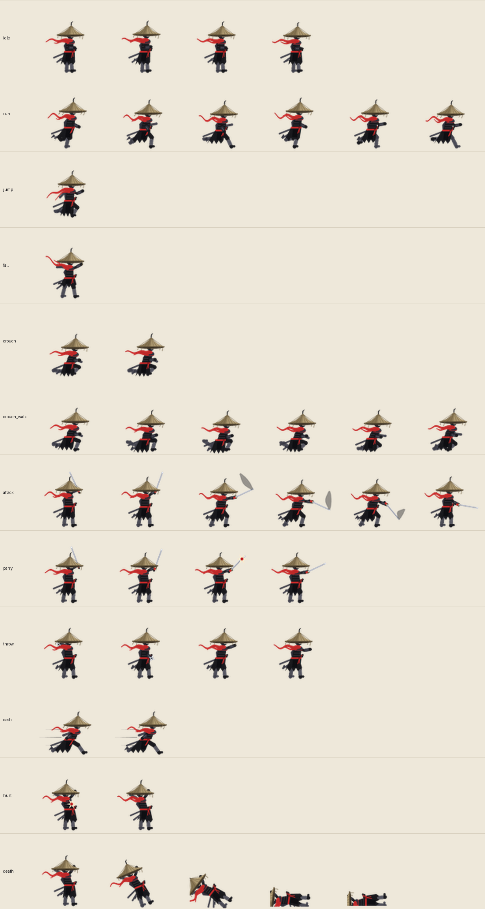

# El protagonista: el Ronin

Documento de diseño. Los valores numéricos son iniciales y se ajustarán en las pruebas de juego.
Las constantes marcadas con `settings.py` ya existen en el código.

## Resumen

Un samurái sin señor, ágil y de combate cercano. No usa armas de fuego: su fuerza está en el
tiempo de reacción (desvío), el posicionamiento (dash y saltos) y la puntería de sus lanzamientos.

| Atributo | Valor |
|---|---|
| Vida | 5 corazones |
| Munición de shuriken | 10 (se recogen más en los niveles) |
| Hitbox | 24 x 58 px (40 px de alto al agacharse) |
| Daño del tajo | 1 |

## Movimiento (implementado)

Todo el movimiento usa delta time (`dt`, en segundos), de modo que la velocidad no depende de los fps.

| Acción | Cómo funciona | Constante (`settings.py`) |
|---|---|---|
| Caminar y correr | La velocidad horizontal se acerca a la velocidad objetivo con aceleración | `RUN_SPEED` = 300 px/s, `GROUND_ACCEL` = 2600 px/s² |
| Frenado | Sin input, la fricción reduce la velocidad hasta cero | `GROUND_FRICTION` = 2200 px/s² |
| Control en el aire | Aceleración menor y frenado leve | `AIR_ACCEL`, `AIR_DRAG` |
| Gravedad | `v.y += g * dt`, con velocidad terminal | `GRAVITY` = 2200 px/s², `MAX_FALL_SPEED` |
| Salto | Velocidad inicial hacia arriba | `JUMP_SPEED` = 780 px/s |
| Salto variable | Soltar el botón en ascenso multiplica la velocidad vertical por 0,45 | `JUMP_CUT` |
| Coyote time | Se puede saltar hasta 0,10 s después de dejar un borde | `COYOTE_TIME` |
| Jump buffer | Un salto pedido hasta 0,12 s antes de aterrizar se ejecuta al tocar el suelo | `JUMP_BUFFER` |
| Hielo | `grip` del nivel multiplica aceleración y fricción del suelo (0,15 en hielo) | parámetro `;grip=` del nivel |

Cálculos de referencia:
- Altura máxima del salto: `h = v² / (2g) = 780² / (2 * 2200) ≈ 138 px` (unos 4,3 bloques).
- Tiempo hasta el punto más alto: `t = v / g ≈ 0,35 s`.
- Cada frame: `v += a * dt`, luego `pos += v * dt` (Euler semiimplícito), resolviendo las colisiones eje por eje.

## Habilidades

Estado: implementados el movimiento, agacharse, el dash y el shuriken (con su trayectoria). El tajo ya hiere a los enemigos. El desvío ya devuelve las flechas del arquero hacia el cursor.

### Tajo (clic izquierdo)
- La katana barre un arco de 120° centrado en la dirección del mouse.
- Duración 0,2 s, es decir, una velocidad angular de 600°/s. Recarga de 0,35 s.
- Golpea a un enemigo si su centro está dentro del radio (80 px) y su ángulo respecto del jugador cae dentro del arco que ya recorrió la hoja.
- Física: movimiento rotacional y ángulos entre vectores (`atan2`).

### Desvío (clic derecho o K)
- Abre una ventana de 0,2 s (de los 0,05 s a los 0,25 s del movimiento) en la que las flechas que tocan la hoja, una caja de 48 x 56 px delante del Ronin, rebotan.
- **Dirección de salida.** Con el **clic derecho** la flecha sale hacia el cursor. Con la tecla **`K`** sale hacia la dirección de las teclas WASD que se mantengan (8 direcciones: por ejemplo `K` + `W` la manda hacia arriba y `K` + `D` hacia la derecha); si no se mantiene ninguna, sale hacia donde mira el Ronin, o sea de vuelta hacia quien disparó. En ningún caso el desvío gira al Ronin: solo cambia hacia dónde sale la flecha. Si se pulsa `W` junto con `K`, no cuenta como salto.
- Cálculo (álgebra de vectores): sea `v` la velocidad de la flecha y `a` la dirección unitaria apuntada. Para que la flecha salga hacia `a`, la hoja debe tener la normal `n = (|v|·a − v) / ‖|v|·a − v‖`. Después se aplica la **ley de reflexión** `v' = v − 2 (v · n) n`, que conserva el módulo, y se multiplica por 1,25. Si la flecha ya iba hacia donde se apunta, la hoja queda de canto y solo la acelera.
- Si el desvío no toca ninguna flecha, queda **inutilizable 0,6 s**.
- La flecha devuelta deja de herir al Ronin, hiere a los enemigos que toque (2 de daño) y es la única forma de herir seriamente al Samurái Caído.
- Durante el dash el Ronin es invulnerable y las flechas lo atraviesan. Con el desvío no hay invulnerabilidad: si la flecha llega fuera de la ventana o de la hoja, hiere.
- Física: álgebra de vectores (producto punto, normalización, reflexión).

### Shuriken (E)
- **Versión actual:** al pulsar E sale en línea recta hacia donde mira el Ronin (con una leve subida inicial de 60 px/s) y cae por gravedad (600 px/s²). Aún sin munición, sin apuntar con el mouse y sin daño.
- **Versión planificada** (lo que sigue es el diseño completo):
- Al mantener la tecla se dibuja la trayectoria punteada hacia el mouse; al soltar, se lanza.
- Velocidad de lanzamiento 700 px/s. Gira a 720°/s.
- Trayectoria: `x = x0 + vx t`, `y = y0 + vy t + ½ g t²`. La vista previa muestrea la misma fórmula.
- Daño 1. Consume 1 de munición.
- Física: tiro parabólico y descomposición de la velocidad en componentes.

### Dash (Shift)
- Impulso horizontal de 650 px/s durante 0,15 s, con invulnerabilidad en ese lapso.
- **Dash en diagonal:** con `W` (o flecha arriba) + `A`/`D` mantenidas, `Shift` lanza el dash hacia arriba y hacia el lado pulsado. La dirección es el vector unitario `(±1, -1)/√2` y la rapidez sube a 800 px/s (`DASH_DIAGONAL_SPEED`), así que recorre unos 120 px en línea recta (el horizontal, 97 px). Sin gravedad durante el impulso, igual de invulnerable y con la misma recarga; se puede usar en el suelo o en el aire, y un techo lo detiene. Al terminar conserva solo el 35 % de la velocidad (`DASH_DIAGONAL_EXIT_KEEP`) para que no salga planeando lejos. Sin `W` o sin dirección lateral, el dash es el horizontal de siempre.
- Recarga de 1 s. Al terminar el impulso, la inercia se disipa con la fricción del suelo (más larga en hielo).
- Física: momentum, inercia y fricción; el dash diagonal además descompone la velocidad en sus componentes `v·cos 45°` y `v·sen 45°`.

### Agacharse (S)
- Reduce la hitbox de 58 a 40 px de alto (los pies no se mueven) y la velocidad al 40 %. Solo se levanta si hay espacio sobre la cabeza. Permite pasar bajo proyectiles altos y bajo obstáculos bajos.

### Daño y vida
- Cada golpe quita 1 corazón y empuja al jugador (knockback) en dirección opuesta al atacante.
- Tras recibir daño, 1 s de invulnerabilidad con parpadeo.
- Con 0 corazones, el nivel se reinicia desde el último checkpoint.

## Diseño visual y animaciones

**Concepto.** Un ronin errante de rostro cubierto, con la esencia de los samuráis sombríos de las imágenes de
referencia (no se copia ninguna obra, es un diseño propio):
- Sombrero de paja cónico (kasa) con trama y moño, que oculta la mirada
- Rostro cubierto por una máscara de tela, con solo una rendija para los ojos
- Capa y falda raídas, con bordes desgarrados que ondean con el viento y la velocidad
- **Bufanda roja larga** y **cinto de cuerda roja**: son los únicos acentos de color
- Hombreras, pectoral de láminas y antebrazos protegidos
- Dos katanas envainadas en la cadera y una tercera que desenvaina para atacar y desviar

La paleta es negro tinta, grises, paja ocre, rojo y acero, coherente con el estilo de tinta sobre papel del juego.



| Animación | Cuadros | Duración / velocidad | Cuándo se usa | En el juego |
|---|---|---|---|---|
| `idle` | 4 | 5 cuadros/s | Quieto en el suelo (respira, ondea la capa) | Sí |
| `run` | 6 | 12 cuadros/s, escalada por la velocidad real | Se mueve en el suelo | Sí |
| `jump` | 1 | | En el aire subiendo (`vel.y < 0`) | Sí |
| `fall` | 1 | | En el aire bajando | Sí |
| `crouch` | 2 | 3 cuadros/s | Agachado y quieto (S) | Sí |
| `crouch_walk` | 6 | 8 cuadros/s, escalada por la velocidad real | Agachado y avanzando (S + A/D), al 40 % de la velocidad | Sí |
| `dash` | 2 | 0,15 s | Shift | Sí, con movimiento real |
| `attack` | 6 | 0,30 s | Clic izquierdo o J | Sí, hiere entre los 0,06 s y los 0,22 s |
| `parry` | 4 | 0,35 s | Clic derecho (hacia el cursor) o K | Sí, devuelve flechas entre los 0,05 s y los 0,25 s |
| `throw` | 4 | 0,30 s | E | Sí: la estrella sale en el cuadro 3 (a los 0,15 s) |
| `hurt` | 2 | 0,40 s | Recibir un golpe (F2 en modo debug) | Sí, con knockback |
| `death` | 5 | 0,80 s | Quedarse sin vida (F3 en modo debug) | Sí |

Las animaciones de acción duran exactamente lo mismo que la acción (`ACTION_TIME` en `settings.py`):
la velocidad de cuadros se calcula como `cuadros / duración`.

**Cómo se hicieron.** El script `tools/generar_sprites_ronin.py` dibuja al personaje como un esqueleto de
segmentos. Cada extremidad se define con ángulos y la posición de cada articulación se calcula como
`punto_siguiente = punto + longitud * (sen(ángulo), cos(ángulo))` (cinemática directa). Cada cuadro de la
animación es una pose (un conjunto de ángulos). El ciclo de carrera usa funciones seno de la fase, el tajo
barre el sable por un arco y la muerte rota todo el dibujo alrededor de los pies. Esto se puede explicar en el
informe como aplicación de **trigonometría y movimiento rotacional**.

**Cómo se usan en el juego.**
- Cada animación es una tira horizontal de cuadros de 96 x 96 px en `assets/images/ronin/`.
- `Animator` (`src/animation.py`) elige el cuadro con `índice = int(tiempo * fps)`; así la animación depende
  del tiempo y no de los fps de la pantalla. Al empezar una acción se reinicia (`restart=True`).
- `Player.state` decide la animación: primero la acción activa, luego agachado, luego aire (subiendo o bajando),
  luego correr o reposo.
- Los sprites miran a la derecha y se voltean al mirar a la izquierda.
- Los pies del dibujo se alinean con el borde inferior de la hitbox. En el modo debug (F1) se ve la hitbox sobre el sprite.

**Ver las animaciones sin jugar:** `python tools/ver_animaciones.py` abre una galería con todas en bucle (con scroll si no caben en la pantalla; `python tools/ver_animaciones.py zombi` para los zombis, una fila por variante).

**Cambiar el arte.** Para usar dibujos propios basta reemplazar los PNG por tiras con el mismo nombre y cuadros
de 96 x 96 px, con los pies en la fila 90. Para regenerar los actuales: `pip install -r requirements-dev.txt` y
`python tools/generar_sprites_ronin.py --preview`. Pillow solo hace falta para regenerarlos, no para jugar.

## Controles

| Entrada | Acción |
|---|---|
| A / D o flechas | Mover |
| W, Espacio o flecha arriba | Saltar |
| S | Agacharse |
| Mouse | Solo apunta el desvío (con el clic derecho). Nunca gira al Ronin ni cambia el tajo o el shuriken |
| Clic izquierdo | Tajo |
| Clic derecho | Desvío |
| E (mantener y soltar) | Shuriken |
| Shift | Dash (con W + A/D, en diagonal hacia arriba) |
| Esc / P | Pausa |
| R | Reiniciar nivel |
| F1 | Modo debug |

## Estados del protagonista

Para el diagrama de estados del informe:

```
Quieto <-> Corriendo
   |           |
   +--> Saltando --> Cayendo --> (aterriza) Quieto / Corriendo
   +--> Agachado
   +--> Atacando (tajo)       --> vuelve al estado anterior
   +--> Desviando (parry)     --> vuelve al estado anterior (con recarga si falló)
   +--> Dash                  --> Corriendo / Cayendo
   +--> Herido (knockback)    --> Quieto / Cayendo
   +--> Muerto                --> reinicio desde checkpoint
```

## Estado de implementación

| Elemento | Estado |
|---|---|
| Caminar, frenar, gravedad, salto variable, coyote time, jump buffer | Hecho |
| Colisiones con el mapa y caída al vacío | Hecho |
| Agacharse y avanzar agachado (hitbox reducida, velocidad al 40 % y animación propia) | Hecho |
| Dash (impulso, inercia, recarga de 1 s e invulnerabilidad) | Hecho |
| Diseño visual y las 12 animaciones | Hecho |
| Recibir daño y morir (animación y knockback) | Hecho; falta conectarlo a los enemigos |
| Tajo | Hecho: arco de 120° y 64 px, hiere durante 0,16 s y una vez por enemigo (producto punto) |
| Desvío | Hecho: ventana de 0,2 s, reflexión de vectores hacia el cursor, +25 % de velocidad y bloqueo de 0,6 s si falla |
| Shuriken | Hecho: sale de la mano a los 0,15 s, 700 px/s, tiro parabólico, gira a 720°/s y se clava en el mapa; falta que dañe enemigos |
| Vida en corazones (5), invulnerabilidad de 1 s tras un golpe y reinicio al morir | Hecho |
| Checkpoints | Pendiente |
