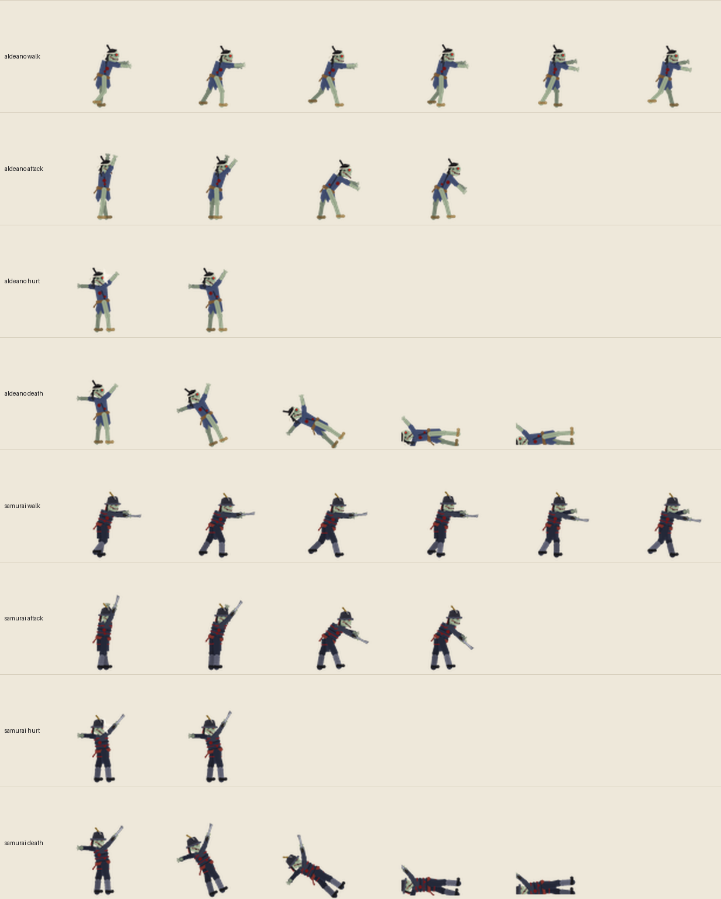
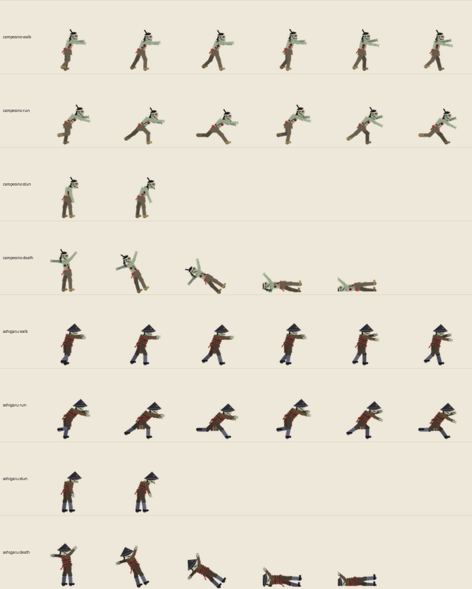
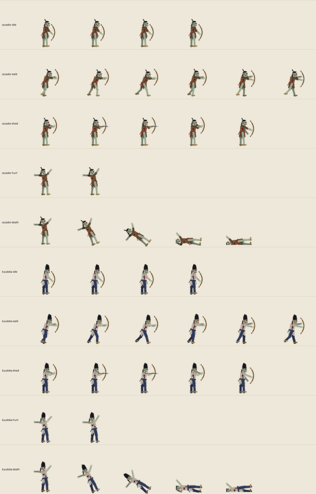
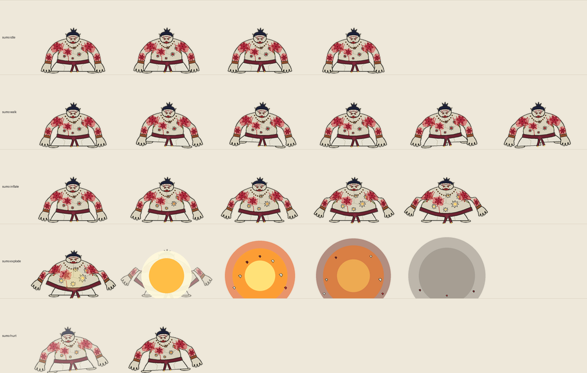

# Enemigos, peligros y jefes

Documento de diseño. Los valores numéricos son iniciales y se ajustarán al probar el juego.
Prioridad: **A** imprescindible, **B** muy deseable, **C** si sobra tiempo.

## Comportamiento común

Todos los enemigos están afectados por la gravedad y colisionan con el mapa igual que el jugador.
Su inteligencia es una máquina de estados sencilla:

```
PATRULLA --(jugador dentro del rango de visión)--> ALERTA / ATAQUE
ATAQUE   --(jugador fuera de rango o ataque terminado)--> PATRULLA
cualquier estado --(golpe recibido)--> AGOTADO (breve) o MUERTO
```

- **Detección:** distancia entre centros. Se compara el cuadrado de la distancia con el cuadrado del rango para evitar la raíz.
- **Patrulla:** avanzan en línea recta y dan la vuelta al llegar a un borde o a una pared.
- **Daño al jugador:** todos infligen 1 corazón y producen knockback. El knockback es un impulso en dirección `normalizar(jugador - enemigo)`.
- **Al recibir un golpe:** son empujados hacia atrás y quedan aturdidos un instante.

## Enemigos comunes

| Tipo | Vida | Movimiento (física) | Ataque | Nivel | Prioridad |
|---|---|---|---|---|---|
| Zombi caminante | 1 | Lento, velocidad constante (MRU) | Zarpazo al contacto | 1 y 2 | A |
| Zombi corredor | 1 | Acelera al ver al jugador (MRUA) y se desliza al frenar | Embestida | 1 y 2 | A |
| Zombi arquero | 2 | Casi estático en plataformas altas; retrocede si el jugador se acerca | Flechas rectas, desviables | 1 y 2 | A |
| Zombi hinchado | 3 | Muy lento y pesado | Se infla y explota (impulso radial) | 2 | B |

### Zombi caminante
- Patrulla a 60 px/s y persigue a 90 px/s si el jugador está a menos de 220 px y a una altura parecida (máx. 90 px de diferencia).
- Ataca con un zarpazo cuando queda a 30 px o menos, con 1 s de recarga entre golpes. El golpe hiere solo en una ventana del ataque (de 0,15 s a 0,30 s) y quita 1 corazón.
- Al patrullar da la vuelta si choca con una pared o si no hay suelo delante (no se cae por los pozos). Al perseguir se detiene en el borde.
- Tiene 1 de vida: un tajo o un shuriken lo matan. Al morir sale empujado, cae y su cuerpo desaparece a los 2 s.
- Cómo vencerlo: un tajo, un shuriken, o saltarlo. Es el enemigo básico para enseñar el combate.
- **Dos variantes de apariencia**, con el mismo comportamiento por ahora:
  - **Aldeano**: campesino japonés de la era samurái, con kimono índigo raído, obi, sandalias de paja y pelo enmarañado con una banda rota.
  - **Samurái**: guerrero caído con casco agrietado y un cuerno roto, pectoral de láminas con cordones desteñidos, hombreras, falda de placas y una katana rota en la mano.
- Animaciones (en `assets/images/zombi/caminante/<variante>_<animación>.png`): `walk` (6 cuadros), `attack` (4, dura 0,40 s), `hurt` (2) y `death` (5, dura 0,80 s).
- En el nivel de pruebas se colocan con las letras `Z` (aldeano) y `X` (samurái), o con las teclas `1` y `2`.



### Zombi corredor
- Patrulla a 80 px/s. Si ve al Ronin a menos de 320 px y a una altura parecida, **embiste** hacia él: acelera a 900 px/s² hasta un tope de 260 px/s. Es un movimiento uniformemente acelerado (`v = v + a·dt`).
- La embestida termina al chocar con una pared, al llegar a 420 px de recorrido o al acercarse a un borde sin suelo (mira por delante la distancia de frenado `v² / 2a`, así no se cae por los pozos).
- Luego **frena por fricción** (1400 px/s²). Si golpeó al Ronin, vuelve a patrullar; si **falló**, queda **aturdido 0,8 s** sin moverse. Esa es la ventana para atacarlo. Tras cada embestida espera 1,2 s antes de repetirla.
- Si el Ronin lo toca durante la embestida le quita 1 corazón (una vez por embestida) y lo empuja.
- Tiene 1 de vida: un tajo o un shuriken lo matan, también cuando va a toda velocidad.
- Cómo vencerlo: **dash** para atravesar la embestida (el Ronin es invulnerable durante el dash, así que la embestida falla y el corredor queda aturdido), un tajo bien cronometrado, o un shuriken a distancia.
- **Dos variantes de apariencia**, con el mismo comportamiento:
  - **Campesino**: flaco, con el torso al aire (costillas y cicatrices), hakama rota y una banda en la frente.
  - **Ashigaru**: soldado raso de la era samurái, con *jingasa* (sombrero cónico de hierro abollado), coraza ligera de cuero con cordones rojos y falda de placas.
- Animaciones (en `assets/images/zombi/corredor/<variante>_<animación>.png`): `walk` (6 cuadros), `run` (6, el ciclo de carrera acelera con la velocidad real), `stun` (2) y `death` (5).
- En el nivel de pruebas se colocan con las letras `R` (campesino) y `A` (ashigaru), o con las teclas `3` y `4`.



### Zombi arquero
- Tiene **2 de vida** y está casi quieto. Si ve al Ronin a menos de 450 px, con línea de visión libre (ningún bloque en medio), dispara una flecha cada 2 s.
- El disparo dura 0,8 s: coloca la flecha, tensa el arco, **suelta a los 0,48 s** y baja el arco. Apunta hacia donde está el Ronin en el instante de soltar, así que moverse mientras tensa sirve para esquivar. La flecha sale a 420 px/s en línea recta (sin gravedad) y quita 1 corazón al tocar al Ronin. Solo dispara si el ángulo es razonable (inclinación máxima de 0,7).
- Si el Ronin se acerca a menos de 150 px, **retrocede** a 80 px/s sin darle la espalda. Si detrás hay un borde o una pared, queda acorralado y dispara a quemarropa.
- Un golpe sin matarlo lo interrumpe: si estaba tensando, no suelta la flecha.
- Cómo vencerlo: **desviar la flecha** (una flecha devuelta hace 2 de daño y lo mata de un golpe), un tajo y un shuriken (2 golpes), o el dash para cruzar su línea de tiro.
- **Dos variantes de apariencia**, con el mismo comportamiento:
  - **Cazador**: cazador de la montaña con chaleco de piel con flecos, pelo enmarañado y un arco largo.
  - **Kyudoka**: arquero de la corte, con kimono desteñido, hakama índigo y *eboshi* (gorro negro de corte).
- Animaciones (en `assets/images/zombi/arquero/<variante>_<animación>.png`): `idle` (4 cuadros), `walk` (6, al retroceder), `shoot` (5, dura 0,8 s), `hurt` (2) y `death` (5).
- En el nivel de pruebas se colocan con las letras `C` (cazador) y `Y` (kyudoka), o con las teclas `5` y `6`.



**Flecha (`Arrow`)**: se mueve en línea recta con `pos += v · dt`, se clava en los bloques y desaparece a los 3 s. Se dibuja orientada según su velocidad. Una flecha devuelta cambia de dueño: deja de herir al Ronin, hiere a cualquier enemigo que toque (2 de daño) y sale un 25 % más rápida.

### Zombi hinchado
- Es un **luchador de sumo zombi**: enorme (hitbox de 60x62 px, el sprite mide 160x128), pálido, con tatuajes de **higanbana** (la flor de la muerte), sangre, piel desgarrada, pantalón blanco ancho, faja roja y moño. No ataca: **explota**.
- **3 de vida** y muy lento (30 px/s patrullando, 48 px/s persiguiendo; ve al Ronin a 260 px). Un golpe casi no lo mueve (60 px/s de retroceso).
- Estados: `patrol` → `chase` → `inflate` → `dead` (explosión). Si el Ronin queda a menos de 34 px de separación, **se infla durante 1 s** (se queda quieto, tiembla, las heridas se ponen al rojo vivo) y revienta. La mecha sigue aunque el Ronin se aleje: ya no se puede cancelar.
- **Si lo matan** (3 golpes) también explota, pero con una mecha corta de 0,45 s para que dé tiempo de huir. Si ya estaba inflándose, la mecha solo se acorta, nunca se alarga. Un golpe que no lo mata no interrumpe la mecha.
- **Explosión** (`apply_blast` y `blast_push` en `src/combat.py`): radio de **110 px**. Para un objetivo a distancia `r` del centro:
  - `falloff = 1 - r / radio` (1 en el centro, 0 en el borde)
  - dirección `n = normalizar(d + (0, -0,6 · r))`, o sea radial con un empujón hacia arriba
  - impulso `Δv = 560 px/s · falloff · n`, que se suma a la velocidad (después actúan la gravedad y la fricción)
- Daño: **2 corazones al Ronin** y **3 a los otros zombis** (mata a cualquiera, incluso a otro hinchado: **reacción en cadena**). El Ronin invulnerable (durante el dash o tras un golpe) esquiva el daño, pero no el empuje.
- Cómo vencerlo: **shuriken desde lejos** (3 impactos), usar su explosión contra otros zombis, o un tajo seguido de alejarse (o hacer dash) antes de que reviente.
- Animaciones (`assets/images/zombi/hinchado/sumo_<animación>.png`, cuadros de 160x128, de frente: no se voltean): `idle` (4), `walk` (6), `inflate` (5, el cuadro sigue a la mecha), `explode` (5, dura 0,6 s) y `hurt` (2). No hay `death`: morir es explotar.
- En el nivel de pruebas se coloca con la letra `H` o con la tecla `7`. Con `F1` se ve el radio de la explosión mientras se infla.



## Peligros del escenario

| Peligro | Comportamiento | Física | Nivel |
|---|---|---|---|
| Sierras giratorias | Giran en su sitio y dañan al contacto (colisión círculo contra caja) | Movimiento rotacional | 1 y 2 |
| Plataformas móviles | Se desplazan en línea recta o en círculo: `pos = centro + r (cos θ, sin θ)`, con `θ = ω t` | Movimiento circular uniforme | 2 |
| Suelo de hielo | `grip` bajo: cuesta arrancar y frenar | Fricción e inercia | 2 |

## Jefes

### Samurái Caído (nivel 1, vida 10)
El antiguo general del ronin, convertido en un muerto viviente.

- **Carga:** corre en línea recta hacia el jugador hasta 500 px/s y queda aturdido 1,5 s al terminar. Es la ventana para el tajo directo (1 de daño).
- **Onda de energía:** lanza un proyectil a 380 px/s cada 3 s. Solo el proyectil devuelto con el desvío le hace daño grande (3). Así el jefe enseña la mecánica central.
- **Fase 2 (menos de la mitad de vida):** carga más rápida y lanza dos ondas en abanico (±15°).

### Oni (nivel 2, vida 15)
Un demonio que custodia el templo y el faro.

- **Salto:** salta en parábola hacia donde está el jugador. La velocidad inicial se calcula con las ecuaciones del tiro parabólico para caer sobre el punto objetivo.
- **Onda de choque:** al caer, daña al jugador si está en el suelo a menos de 160 px (se evita saltando). Después queda aturdido 2 s.
- **Rocas:** lanza rocas en arco; un tajo las destruye.
- **Garrote:** telegrafía el ataque 0,5 s y luego barre un arco de 180° en 0,6 s (movimiento rotacional). Se esquiva con dash.

## Botín (propuesta)

Los enemigos pueden soltar corazones o shuriken (aprox. 20 %). Los jefes sueltan un checkpoint.

## Estado de implementación

| Elemento | Estado |
|---|---|
| Máquina de estados y detección | Hecho para el caminante, el corredor, el arquero y el hinchado |
| Zombi caminante (aldeano y samurái) | Hecho |
| Zombi corredor (campesino y ashigaru) | Hecho |
| Zombi arquero (cazador y kyudoka) y flechas | Hecho |
| Zombi hinchado (sumo) y explosión radial | Hecho |
| Sierras y plataformas móviles | Pendiente |
| Samurái Caído (jefe) | Pendiente |
| Oni | Pendiente |
